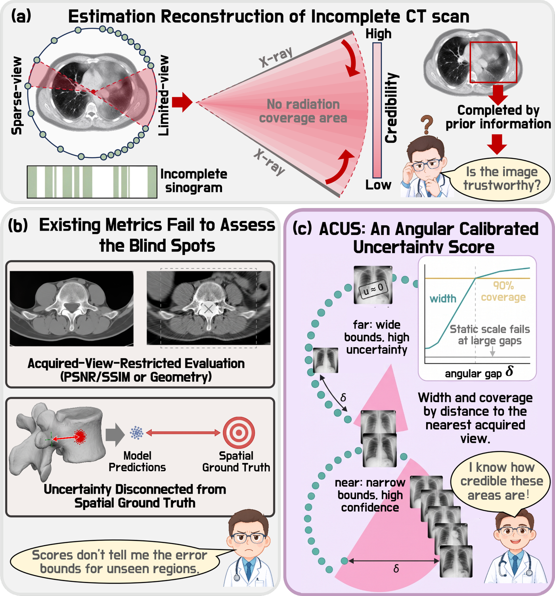
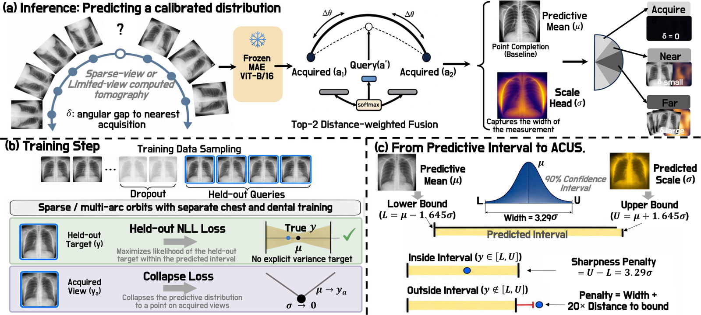
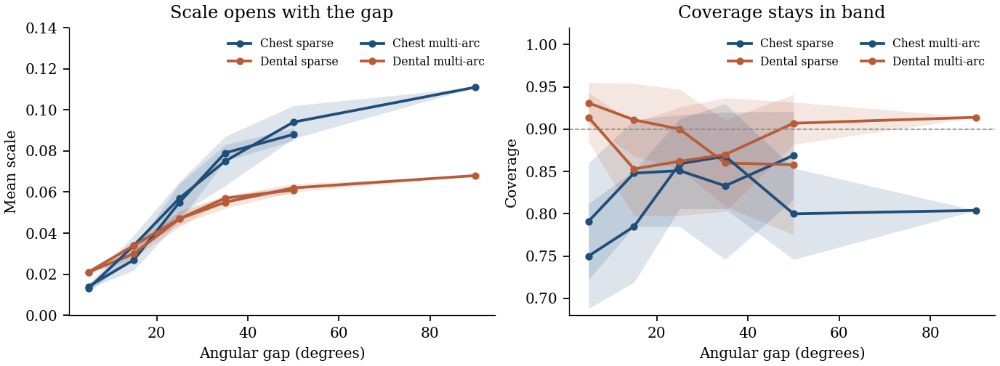

<p align="center">
  
</p>

<h3 align="center">An interval for the angle that was not acquired.</h3>

<p align="center">
  
</p>

---

## Numbers

Forty cases per anatomy, eight acquired views. Near is under 20°. Far is at least 40°.

| | Chest sparse | Chest multi-arc | Dental sparse | Dental multi-arc |
| --- | ---: | ---: | ---: | ---: |
| Far scale | **0.088** | **0.095** | **0.061** | **0.063** |
| Far coverage | 0.87 | 0.80 | 0.86 | 0.91 |
| Near scale | 0.018 | 0.023 | 0.024 | 0.027 |

<p align="center">
  
</p>

Chest sparse scale rises from 0.014 to 0.088. Coverage stays between 0.75 and 0.93.

<p align="center">
  
  &nbsp;
  
</p>

<p align="center">One chest query and one dental query. Columns are image, scale, absolute residual, and pixels outside the interval. These two cases are not the forty-case mean.</p>

---

## Run

```text
acus/ctorbit/train.py      training step
acus/ctorbit/model.py      scale head and forward pass
acus/eval_fiber_main.py    held-out near and far evaluation
acus/acus_core.py          score and the two losses
acus/configs/               chest and dental settings
```

```bash
pip install -r requirements.txt
cd acus
python -m ctorbit.train --config configs/luna_fiber.yaml
python eval_fiber_main.py --fiber_cfg configs/luna_fiber.yaml --fiber_ckpt chest.pt --point_cfg configs/luna_s1.yaml --point_ckpt chest_point.pt --outdir outputs/chest
```

`luna_*` is chest. `tooth_*` is dental. Point `data.roots` and `model.mae_ckpt` at local files. Checkpoints are not in this repository.

<p align="center">MIT</p>
