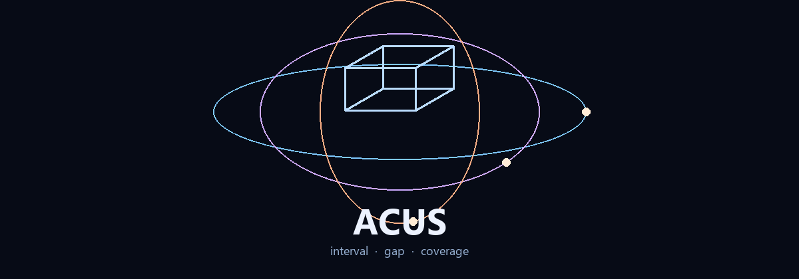
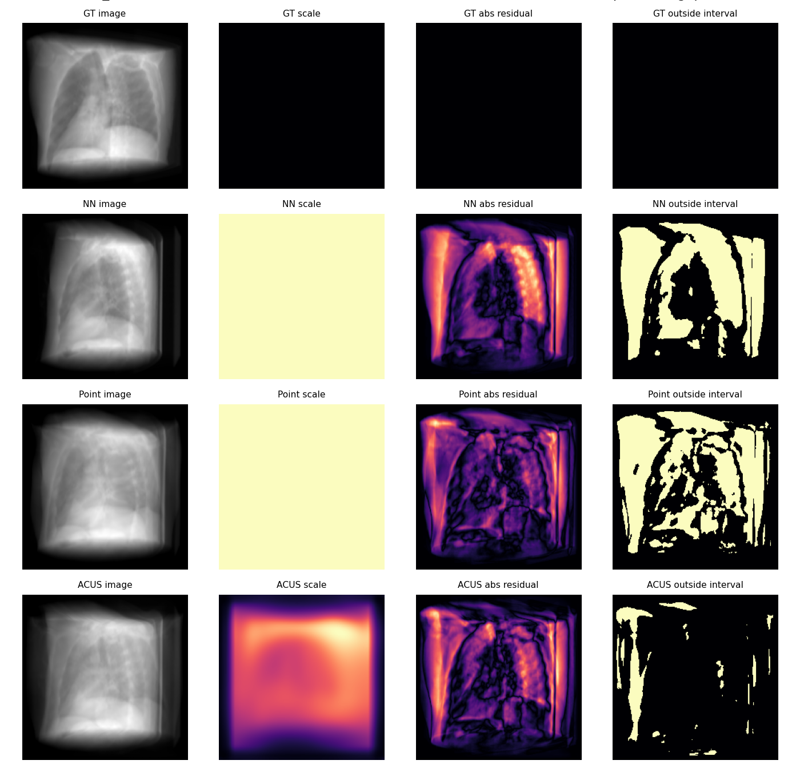
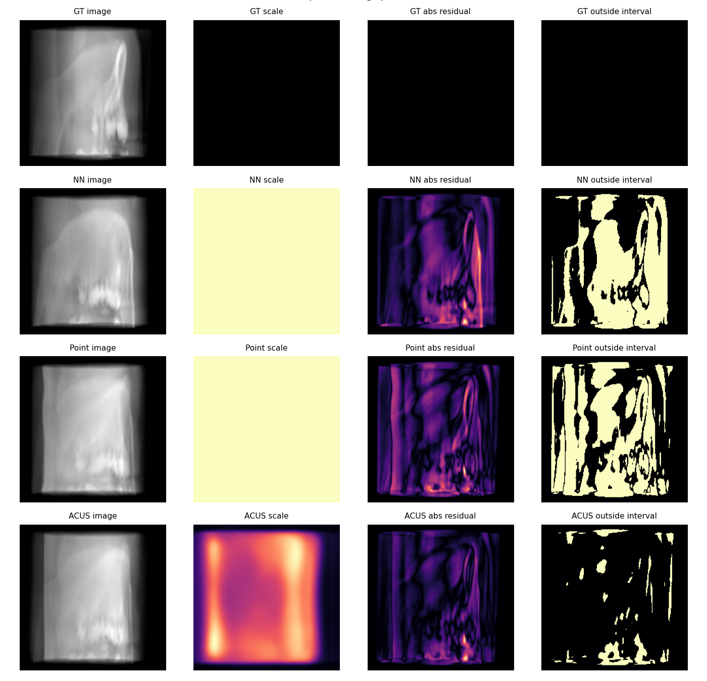

<p align="center">
  
</p>

<h2 align="center">An interval for the angle that was not acquired.</h2>

<p align="center">
<code>3.29 × scale</code> + <code>20 × exceedance</code>
</p>

A held-out projection is scored by its distance to the nearest acquired view.
The interval is a nominal 90% band. Width is charged. Pixels outside the band are charged again.
A single residual scale does not cover far angles. A learned scale opens with the gap.

---

## Result

Forty cases per anatomy, eight acquired views. Near is under 20°. Far is at least 40°.

| | Chest sparse | Chest multi-arc | Dental sparse | Dental multi-arc |
| --- | ---: | ---: | ---: | ---: |
| Far scale | **0.088** | **0.095** | **0.061** | **0.063** |
| Far coverage | 0.87 | 0.80 | 0.86 | 0.91 |
| Near scale | 0.018 | 0.023 | 0.024 | 0.027 |

<p align="center">
  
</p>

---

## Boards

<p align="center">
  
</p>

<p align="center">Chest, one mid-gap query. A constant scale is a flat field. The learned scale has structure. One case, not the forty-case mean.</p>

<p align="center">
  
</p>

<p align="center">Dental, same columns: image, scale, absolute residual, pixels outside the interval.</p>

---

## Layout

```text
acus/ctorbit/train.py     training step
acus/ctorbit/model.py     ScaleHead and the forward pass
acus/eval_fiber_main.py   held-out near/far evaluation
acus/acus_core.py         score and the two losses, without the trainer
acus/configs/              chest and dental settings
```

```bash
pip install -r requirements.txt
cd acus
python -m ctorbit.train --config configs/luna_fiber.yaml
python eval_fiber_main.py --fiber_cfg configs/luna_fiber.yaml --fiber_ckpt chest.pt --point_cfg configs/luna_s1.yaml --point_ckpt chest_point.pt --outdir outputs/chest
```

`luna_*` is chest. `tooth_*` is dental. Set `data.roots` in the yaml to the local projection folders. The frozen encoder path is `model.mae_ckpt`. Checkpoints are not in this repository.

---

<p align="center">MIT</p>
